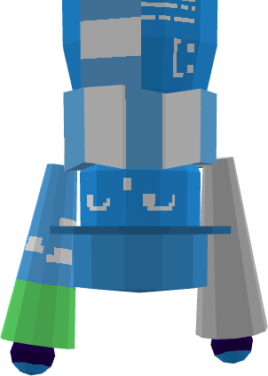

# `ypx.13/readme.md    🗕 🗖 🗙`

> **"niche of niche."**

welcome welcome! you might already know me from my socials, youtube, github, or discord. i'm **ypx.13** (or just **yp**). i build niche desktop apps in categories you didn't know you needed on your desktop — until now ;)

---

### `[ WORK ]`

- working on updates for **[TaskTile](https://github.com/ypx13/TaskTile)**
- building my website, this profile acts as one for now

---

### `[ LANGUAGES ]`

  
  &nbsp;
  
  &nbsp;
  
  &nbsp;
  
  &nbsp;
  
  &nbsp;
  

> mostly the basics except C# ig, oh, and english too, im not no robot
---

### `[ [[BIGSHOTS]] ]`

*  **[TaskTile](https://github.com/ypx13/TaskTile)** — a truly tactile (ba dum tssh ;D) windows taskbar utility!

### `[ SYSTEM ]`

  
<b>click to inspect [ HARDWARE ]</b>

   
  <ul>
    <li><b>cpu/</b>AMD Ryzen 7 7700</li>
    <li><b>gpu/</b>AMD Radeon RX 7600</li>
    <li><b>ram/</b>32GB</li>
    <li><b>os/</b>msDOS</li>
  </ul>

